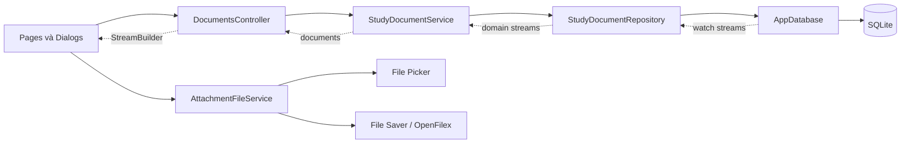

# Kiến trúc dự án Study Docs

## Tổng quan

Study Docs là ứng dụng Flutter lưu tài liệu và file đính kèm cục bộ bằng SQLite/Drift. Kiến trúc lấy cảm hứng từ cách Cashew tổ chức tầng dữ liệu, dependency/state management và dữ liệu reactive; repository/service được thêm để làm rõ ranh giới nghiệp vụ.

Đây là cách áp dụng các nguyên lý, không phải bản sao cấu trúc hay mã nguồn của Cashew.

## Cấu trúc thư mục

| Thư mục | Trách nhiệm |
|---|---|
| `lib/core/utils` | Enum loại tài liệu, định dạng ngày và dung lượng file. |
| `lib/domain/models` | Model tài liệu, metadata attachment, file chờ lưu và payload Blob. |
| `lib/domain/services` | Validation, UUID, điều phối CRUD và luật attachment. |
| `lib/data/database` | Schema Drift, migration, truy vấn stream và thao tác SQLite. |
| `lib/data/repositories` | Mapping giữa row/companion Drift và model domain; transaction ghi dữ liệu. |
| `lib/data/services` | Adapter cho file picker, lưu và mở file theo nền tảng. |
| `lib/presentation/controllers` | Trạng thái tìm kiếm và bộ lọc được cung cấp qua Provider. |
| `lib/presentation/pages`, `lib/presentation/widgets` | Danh sách và Dialog tạo/sửa/chi tiết. |

`main.dart` khởi tạo `AppDatabase` và đăng ký database, repository, service, file service cùng controller trong `MultiProvider`.

## Luồng phụ thuộc và dữ liệu



- Controller giữ keyword/type và phát `notifyListeners()` khi query state thay đổi.
- Service xác thực dữ liệu, sau đó gọi repository; widget không tự tạo SQL.
- Repository map kết quả database thành model domain và trả `Stream` cho service/controller/UI.
- Drift `watch()` tự phát lại khi các bảng liên quan thay đổi.

## Schema và migration

`AppDatabase` trong [app_database.dart](../lib/data/database/app_database.dart) là nơi khai báo schema:

- `study_documents`: id UUID, title, type, subject, note nullable, createdAt.
- `attachments`: id UUID, documentId FK, fileName, extension, mimeType nullable, sizeBytes, bytes Blob, createdAt.

`schemaVersionGlobal` hiện là `2`. Migration từ version cũ tạo bảng attachments mà không xóa tài liệu đang có. Trong `beforeOpen`, database bật `PRAGMA foreign_keys = ON`; xóa document cascade xuống attachments.

Mã Drift generate nằm tại `lib/data/database/app_database.g.dart`; chỉnh schema ở file nguồn rồi chạy:

```shell
dart run build_runner build
```

## Truy vấn Blob có chủ đích

Danh sách chính dùng `selectOnly` cho cột document, `LEFT JOIN` và `COUNT` attachment. Query không lấy cột `bytes`, nên danh sách lớn không kéo nội dung file vào bộ nhớ.

Danh sách file dùng projection metadata riêng (`watchAttachments`). Chỉ thao tác tải/mở mới gọi `readAttachmentBytes(id)` để đọc Blob. File picker đọc bytes trực tiếp và không dựa vào file path, phù hợp với web.

## Quy tắc nghiệp vụ file

`StudyDocumentService` đảm nhiệm:

- Validate tiêu đề/môn học không rỗng và type thuộc enum hợp lệ.
- Validate extension trong whitelist: pdf, doc, docx, ppt, pptx, xls, xlsx, txt, png, jpg, jpeg, zip.
- Giới hạn kích thước mỗi file ở 10 MiB.
- Tạo UUID cho document/attachment.
- Phối hợp lưu document và các file chờ trong cùng transaction để rollback đồng bộ nếu một insert lỗi.

`AttachmentFileService` chọn nhiều file qua `file_picker`, map MIME type, dùng `file_saver` để xuất file và gọi `OpenFilex` trên native. Trên web, bytes được chuyển cho browser download.

## Presentation

Các popup dùng `showDialog`/`Dialog`, giới hạn chiều rộng 560 px và cuộn được. Danh sách tài liệu nhận stream, hỗ trợ tìm kiếm/lọc, hiển thị attachment count và yêu cầu xác nhận khi xóa. Attachment row hiển thị metadata và menu tải/mở, đổi tên, thay hoặc xóa.

## Kiểm thử

- `test/attachment_test.dart`: migration giữ dữ liệu cũ, foreign keys, lưu nhiều file, đọc Blob riêng, cascade delete, transaction rollback và giới hạn file.
- `test/widget_test.dart`: validate form, CRUD document, tìm kiếm, lọc, Dialog chi tiết và xác nhận xóa.

## Trạng thái giao diện cần lưu ý

Trong source hiện tại, hàng nút **“Chọn file”** ở [document_form_dialog.dart](../lib/presentation/widgets/document_form_dialog.dart) và **“Thêm file”** ở [document_details_dialog.dart](../lib/presentation/widgets/document_details_dialog.dart) đang bị comment. Vì vậy service/database đã có luồng attachment nhưng người dùng chưa thể bắt đầu thêm file từ hai Dialog đó. Cần bật lại các nút này để hoàn thiện cả luồng tạo kèm file và thêm file sau.

Repository hiện dùng trực tiếp `AppDatabase`, chưa có repository interface hoặc DAO riêng. Đây là lựa chọn đơn giản cho quy mô hiện tại; có thể bổ sung abstraction nếu cần mock/in-memory backend hoặc mở rộng nhiều nguồn dữ liệu.
